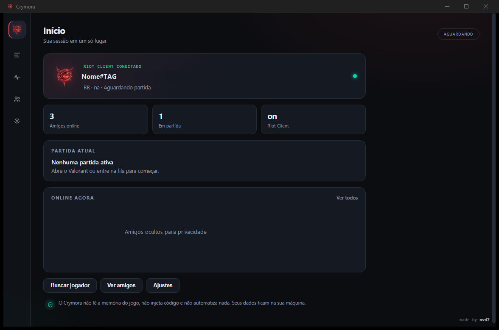

<div align="center">


# Crymora

**Your local Valorant companion.**  
Matches, friends, tracker and settings in a fast, clean, read-only desktop app.

[](https://github.com/nvd7/crymora/releases/latest)
[](https://github.com/nvd7/crymora/releases/latest)
[](https://github.com/nvd7/crymora/actions/workflows/ci.yml)
[](#installation)
[](https://www.rust-lang.org/)
[](https://tauri.app/)
[](LICENSE)

[Website](https://nvd7.github.io/crymora/) · [Install](#installation) · [Features](#features) · [Security](#security-and-privacy) · [How it works](#how-it-works) · [Architecture](docs/ARCHITECTURE.md) · [Build](#build-from-source) · [FAQ](#frequently-asked-questions) · [Português](README.md)

</div>



## About

Crymora is a Windows desktop app that brings together what you need to know before and during a Valorant match: both teams in pre-game, your online friends, a complete profile for any Riot ID, and appearance and behavior settings.

It talks **only** to the Riot Client installed on your machine and to public Riot services. There is no custom backend, telemetry, cloud account or data collection. Everything stays on your computer.

> **Status:** first public release (`v0.1.0`). The UI and backend are stable for daily use, and the project continues to evolve.

> [!WARNING]
> **Riot Games notice — read before using.**  
> Crymora is not affiliated with, endorsed by or approved by Riot Games. It uses unofficial local Riot Client APIs in read-only mode. Riot does not maintain a public list of safe apps and does not guarantee third-party apps.  
> **This version shows enemies during pre-game, including rank and level.** Riot classifies “scouting” — looking up opponent statistics before a match — as **unapproved use** and states that unauthorized apps that obtain hidden client information may result in a ban. **Use at your own risk and do not share it with anyone who has not accepted that risk.**  
> Crymora **is not a cheat**: it does not read game memory, inject code, create overlays, automate input or modify game files.

## Features

### Home

- Session overview: Riot Client connection, online friends and current match.
- Shortcuts to match, friends, player search and settings.
- Immediate refresh when the app regains focus (Alt+Tab).

### Match

- **Pre-game with both teams visible**, including enemy nicknames, ranks and levels.
- Full roster during the match, with allies and opponents.
- Map, mode, live score and party indicators.
- Smart rank wait: the roster is only shown when ranks are confirmed (or released within 5 seconds with whatever is available).

### Friends

- Online-first list, straight from Valorant client presence.
- Status, activity, rank and level when available.
- Initials avatar fallback for friends without a card or known level — no fake level 0.
- Player details in a modal, with a shortcut to the public profile.

### Tracker

- Local search by **Riot ID** (`Name#TAG`), with suggestions from friends and players seen in recent matches.
- Full profile: current rank and RR, career peak, act peak, act wins/losses, previous act, leaderboard, career matches and recent results.
- Career peak is calculated from act history and has been checked against tracker.gg.
- External fallback to open any Riot ID on tracker.gg.

### Settings

- Theme, accent color, density, animations and background effects.
- Language (Portuguese and English), launch on Windows startup and match alerts.
- Discord Rich Presence (optional, off by default).
- Privacy and security controls visible in the app.

### Extras

- Tray icon with a native menu and “close to tray” behavior.
- Context menu with settings, language, reload, minimize and quit.
- Per-user installer, no administrator required.
- Account switching detected by puuid: nickname, friends and cache are rebuilt without restarting the app.

## Security and privacy

Crymora is designed to be a **passive reader** of the local Valorant ecosystem.

| Guarantee | How it is enforced |
| --- | --- |
| Read-only | Local Riot Client APIs (including pre-game `loadouts`) and `ShooterGame.log` reading only |
| No game memory | No `ReadProcessMemory` or similar |
| No injection or hooks | No DLLs, remote threads or interception |
| No overlay | A regular desktop window, outside the game |
| No automation | No synthetic input or macros |
| No game modification | No Valorant file is changed |
| No telemetry | No custom server, analytics or tracking |
| Local data | Settings and logs live in `%APPDATA%\crymora` |
| External links | Only `tracker.gg` and `twitch.tv` (HTTPS), validated in the backend |
| Minimal surface | Strict CSP, no opener for the page and a settings allowlist |

Full details in [docs/PRIVACY.md](docs/PRIVACY.md) and [SECURITY.md](SECURITY.md).

## Installation

### Requirements

- Windows 10 or 11, 64-bit.
- WebView2 Runtime (included in Windows 11; on Windows 10 it can be installed from Microsoft).
- Riot Client and Valorant installed for match and friend data.

### Steps

1. Download the latest installer from [**Releases**](https://github.com/nvd7/crymora/releases/latest):

   [**Download the installer**](https://github.com/nvd7/crymora/releases/latest) · 3.26 MiB

   ```text
   Crymora_0.1.0_x64-setup.exe
   ```

2. Check the SHA-256 published in [`builds/final/SHA256SUMS.txt`](builds/final/SHA256SUMS.txt):

   ```powershell
   Get-FileHash .\Crymora_0.1.0_x64-setup.exe -Algorithm SHA256
   ```

3. Run the installer. It installs **for the current user only**, in `%LOCALAPPDATA%\Crymora`, without asking for administrator rights.
4. Open Crymora from the Start Menu or the shortcut created by the installer.

> [!NOTE]
> The executable **is not digitally signed** (there is no code signing certificate). On first run, Windows SmartScreen may show a warning: click **More info → Run anyway**. The complete source code is in this repository for auditing.

To uninstall: **Settings → Apps → Crymora → Uninstall**, or run `%LOCALAPPDATA%\Crymora\uninstall.exe`.

## How it works

```text
┌──────────────────────────────┐
│ Riot Client / Valorant       │
│  • local lockfile            │
│  • glz / pd APIs             │
│  • ShooterGame.log           │
└──────────────┬───────────────┘
               │ read-only
               ▼
┌──────────────────────────────┐
│ Rust backend (Tauri 2)       │
│  • discovery and auth        │
│  • polling and cache         │
│  • roster normalization      │
└──────────────┬───────────────┘
               │ IPC
               ▼
┌──────────────────────────────┐
│ Static UI (HTML/CSS/JS)      │
│  Home · Match · Friends      │
│  Tracker · Settings          │
└──────────────────────────────┘
```

1. The backend finds the Riot Client through the local lockfile and uses the session token to query Riot's own APIs.
2. A poller refreshes presence, match and ranks at short intervals; when the window regains focus, the UI requests an immediate refresh.
3. In pre-game, the Riot payload only contains the allied team. Crymora queries the local `loadouts` endpoint, which returns the `Subject` of all 10 players, and uses `ShooterGame.log` as a fallback. Each puuid is enriched with nickname and rank via PD.
4. The UI receives a normalized roster and renders both teams without accessing anything directly.

More details in [docs/ARCHITECTURE.md](docs/ARCHITECTURE.md).

## Build from source

### Prerequisites

- [Rust](https://rustup.rs/) with the MSVC toolchain and Visual Studio C++ Build Tools.
- [Tauri CLI 2](https://tauri.app/start/):
  ```powershell
  cargo install tauri-cli --version "^2"
  ```
- WebView2 Runtime.
- NSIS is downloaded automatically by Tauri on the first bundle.

The frontend is static (`ui/`), so **there is no npm, Node or web build step**.

### Run in development mode

```powershell
git clone https://github.com/nvd7/crymora.git
cd crymora\src-tauri
cargo run
```

### Tests

```powershell
cd crymora\src-tauri
cargo test --lib
```

### Build the installer

```powershell
cd crymora\src-tauri
cargo tauri build
```

Expected output:

```text
src-tauri\target\release\bundle\nsis\Crymora_0.1.0_x64-setup.exe
```

## Project structure

```text
crymora/
├─ ui/                    static frontend (HTML, CSS and vanilla JS)
│  ├─ index.html
│  ├─ app.js
│  ├─ styles.css
│  └─ assets/             fonts and logo
├─ src-tauri/             Rust backend + Tauri configuration
│  ├─ src/
│  │  ├─ lib.rs           IPC commands and bootstrap
│  │  ├─ settings.rs      settings.json with an allowlist
│  │  ├─ discord_rp.rs    optional Discord presence
│  │  └─ riot/            lockfile, region, HTTP, poller and roster
│  ├─ capabilities/
│  ├─ icons/
│  ├─ tauri.conf.json
│  └─ Cargo.toml
├─ docs/                  architecture, privacy, website and assets
├─ builds/final/          published installer and checksums
├─ design/                visual identity and mockups
├─ tools/                 helper scripts (icon and probing)
├─ .github/               issue/PR templates, Dependabot and CI
├─ CHANGELOG.md
├─ CONTRIBUTING.md
├─ LICENSE
├─ README.en.md
├─ README.md
└─ SECURITY.md
```

## Data sources

| Source | Purpose | Access |
| --- | --- | --- |
| Riot Client lockfile | Local session port and token | Local read |
| Local `glz` / `pd` APIs | Match, roster, ranks, names and presence | Authenticated read with the local token |
| Local `pregame/.../loadouts` API | `Subject` of all 10 players in pre-game | Authenticated read with the local token |
| `ShooterGame.log` | Fallback for enemy puuids in pre-game | Local read |
| `valorant-api.com` | Rank, agent and map icons | Public HTTPS |
| `tracker.gg` / `twitch.tv` | External profiles and streams | Links opened in the browser only |

## Roadmap

- [x] Home, Match, Friends, Tracker and Settings.
- [x] Pre-game with both teams, ranks and levels.
- [x] Immediate refresh when the app regains focus.
- [x] Account switching without restarting.
- [x] Pre-game enemies via `loadouts`, with the game log as a fallback.
- [ ] Recent match history in the Tracker.
- [ ] More languages beyond Portuguese and English.
- [ ] Code signing for the installer.
- [ ] Integration tests with the Riot Client in CI.

## Frequently asked questions

<details>
<summary><strong>Is Crymora a cheat?</strong></summary>

No. It does not read game memory, inject code, create overlays, automate input or modify Valorant files. It is a passive reader of local APIs and logs.

</details>

<details>
<summary><strong>Why does Windows show a warning when installing?</strong></summary>

Because the installer is not digitally signed yet. This is common in independent projects. The source code is public and the binary SHA-256 is published with the release.

</details>

<details>
<summary><strong>Do I need to keep Valorant open?</strong></summary>

Yes. Crymora uses the local Riot Client session. Without the client open, it shows an offline state and cannot list matches or friends.

</details>

<details>
<summary><strong>Is my data sent to any server?</strong></summary>

No. Crymora has no custom backend and no telemetry. The only connections are to the local Riot Client, Riot's own endpoints and the public `valorant-api.com` CDN for icons.

</details>

<details>
<summary><strong>Why do enemies appear in pre-game?</strong></summary>

Because the app queries the local pre-game `loadouts` endpoint, which returns the `Subject` of all 10 players, and uses `ShooterGame.log` as a fallback. This is what Riot calls “scouting” and **it is not approved use**. Read the warning at the top of this README and use it at your own risk.

</details>

<details>
<summary><strong>Do friends without a card or level show level 0?</strong></summary>

No. When the level or card is unknown, the app uses an initials avatar and simply omits the level instead of showing a fake value.

</details>

<details>
<summary><strong>Does the career peak match tracker.gg?</strong></summary>

Yes. The peak is calculated from the act history returned by PD and has been validated against tracker.gg for the tested accounts.

</details>

## Community

- [GitHub Discussions](https://github.com/nvd7/crymora/discussions) — questions, ideas, feedback and settings.
- [Issues](https://github.com/nvd7/crymora/issues) — reproducible bugs and focused suggestions.
- [Security](SECURITY.md) — vulnerabilities, always through a private channel.

## Support the project

If Crymora helped you, leave a **star** on the repository. It helps the project show up for other players and keeps development active.

## Contributing

Contributions are welcome. Before opening a PR, read [CONTRIBUTING.md](CONTRIBUTING.md) and the [Code of Conduct](CODE_OF_CONDUCT.md).

Non-negotiable principle: **Crymora stays read-only**. PRs that add memory reading, injection, hooks, overlays, input automation or any way to bypass game protections will be rejected.

## License

Distributed under the [MIT](LICENSE) license. © 2026 nvd7.

## Credits

- Development and visual identity: [nvd7](https://github.com/nvd7).
- Rank, agent and map icons: [valorant-api.com](https://valorant-api.com).
- Typography: [Geist](https://vercel.com/font) (Vercel).

---

<div align="center">

**made by nvd7**

Crymora is not affiliated with, endorsed by or sponsored by Riot Games.  
VALORANT and Riot Games are trademarks or registered trademarks of Riot Games, Inc.

</div>

## Português

O Crymora é um companheiro local e somente leitura de Valorant para Windows. Leia o [README em português](README.md) para recursos, instalação, segurança e perguntas frequentes.
