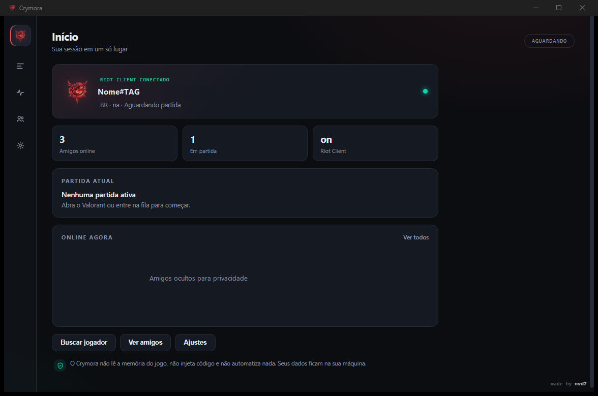

<div align="center">


# Crymora

**Seu companheiro local de Valorant.**  
Partida, amigos, tracker e ajustes em uma interface rápida, limpa e somente leitura.

[](https://github.com/nvd7/crymora/releases/latest)
[](https://github.com/nvd7/crymora/releases/latest)
[](https://github.com/nvd7/crymora/actions/workflows/ci.yml)
[](#instalação)
[](https://www.rust-lang.org/)
[](https://tauri.app/)
[](LICENSE)

[Site](https://nvd7.github.io/crymora/) · [Instalar](#instalação) · [Recursos](#recursos) · [Segurança](#segurança-e-privacidade) · [Como funciona](#como-funciona) · [Arquitetura](docs/ARCHITECTURE.md) · [Compilar](#compilar-do-código-fonte) · [FAQ](#perguntas-frequentes) · [English](README.en.md)

</div>



## Sobre

O Crymora é um aplicativo desktop para Windows que reúne, em um só lugar, o que você precisa saber antes e durante uma partida de Valorant: os dois times no pré-jogo, seus amigos online, o perfil completo de qualquer Riot ID e ajustes de aparência e comportamento.

Ele conversa **apenas** com o Riot Client instalado na sua máquina e com serviços públicos da Riot. Não existe backend próprio, telemetria, conta na nuvem ou coleta de dados. Tudo fica no seu computador.

> **Status:** release pública atual (`v0.1.1`). A interface e o backend são estáveis para uso diário, e o projeto continua em evolução.

> [!WARNING]
> **Aviso da Riot Games — leia antes de usar.**  
> O Crymora não é afiliado, endossado ou aprovado pela Riot Games. Ele utiliza APIs locais não oficiais do Riot Client, em modo somente leitura. A Riot não mantém uma lista pública de aplicativos seguros e não garante aplicativos de terceiros.  
> **Esta versão mostra os inimigos já no pré-jogo, com rank e nível.** A Riot classifica “scouting” — consultar estatísticas de adversários antes da partida — como uso **não aprovado** e afirma que aplicativos não autorizados que obtêm informações ocultas do cliente podem resultar em banimento. **Use por sua conta e risco e não compartilhe com quem não aceitou esse risco.**  
> O Crymora **não é um cheat**: não lê a memória do jogo, não injeta código, não cria overlay, não automatiza entrada e não altera arquivos do jogo.

## Recursos

### Início

- Visão geral da sessão: Riot Client conectado, amigos online e partida atual.
- Atalhos para partida, amigos, busca de jogador e ajustes.
- Atualização imediata ao voltar o foco para o app (Alt+Tab).

### Partida

- **Pré-jogo com os dois times visíveis**, incluindo nick, rank e nível dos inimigos.
- Roster completo durante a partida, com aliados e adversários.
- Mapa, modo, placar ao vivo e indicação de party.
- Espera inteligente pelos elos: a tela só monta o roster quando os ranks estão confirmados (ou libera em até 5 s, com o que estiver disponível).

### Amigos

- Lista online primeiro, direto da presença do cliente do Valorant.
- Status, atividade, rank e nível quando disponíveis.
- Fallback de avatar por iniciais para amigos sem card ou sem nível conhecido — sem inventar nível 0.
- Detalhes do jogador em modal, com atalho para o perfil público.

### Tracker

- Busca local por **Riot ID** (`Nome#TAG`), com sugestões de amigos e jogadores vistos em partidas recentes.
- Perfil completo: rank atual e RR, pico de carreira, pico do ato, vitórias/derrotas do ato, ato anterior, leaderboard, partidas na carreira e últimos resultados.
- O pico de carreira é calculado a partir do histórico de atos e foi conferido contra o tracker.gg.
- Fallback externo para abrir qualquer Riot ID no tracker.gg.

### Ajustes

- Tema, cor de destaque, densidade, animações e efeitos de fundo.
- Idioma (português e inglês), iniciar com o Windows e alertas de partida.
- Presença no Discord (opcional, desligada por padrão): mapa e modo, placar ao vivo, tempo de sessão, logo e botão para o GitHub.
- O Discord não mostra botões de Rich Presence para a própria conta que transmite a presença; o botão “GitHub” aparece para amigos e outras contas.
- Controles de privacidade e segurança visíveis no próprio app.

### Extras

- Ícone de bandeja com menu nativo e comportamento “fechar para a bandeja”.
- Menu de contexto com configurações, idioma, recarregar, minimizar e sair.
- Instalador por usuário, sem necessidade de administrador.
- Troca de conta detectada pelo puuid: nick, amigos e cache são refeitos sem reiniciar o app.

## Segurança e privacidade

O Crymora foi desenhado para ser um **leitor passivo** do ecossistema local do Valorant.

| Garantia | Como é aplicada |
| --- | --- |
| Somente leitura | Apenas APIs locais do Riot Client (incluindo `loadouts`) e leitura do `ShooterGame.log` |
| Sem memória do jogo | Nenhum acesso a `ReadProcessMemory` ou similares |
| Sem injeção ou hooks | Nenhuma DLL, thread remota ou interceptação |
| Sem overlay | A janela é um app desktop comum, fora do jogo |
| Sem automação | Nenhum input sintético ou macro |
| Sem alteração do jogo | Nenhum arquivo do Valorant é modificado |
| Sem telemetria | Nenhum servidor próprio, analytics ou rastreamento |
| Dados locais | Configurações e logs ficam em `%APPDATA%\crymora` |
| Links externos | Apenas `tracker.gg` e `twitch.tv` (HTTPS), validados no backend |
| Superfície mínima | CSP restritiva, sem `opener` para a página e whitelist de settings |

Detalhes completos em [docs/PRIVACY.md](docs/PRIVACY.md) e [SECURITY.md](SECURITY.md).

## Instalação

### Requisitos

- Windows 10 ou 11, 64 bits.
- WebView2 Runtime (já incluído no Windows 11; no Windows 10 pode ser instalado pela Microsoft).
- Riot Client e Valorant instalados para o app mostrar partidas e amigos.

### Passos

1. Baixe o instalador mais recente em [**Releases**](https://github.com/nvd7/crymora/releases/latest):

   [**Baixar o instalador**](https://github.com/nvd7/crymora/releases/latest) · 3,24 MiB

   ```text
   Crymora_0.1.1_x64-setup.exe
   ```

2. Confira o SHA-256 publicado em [`builds/final/SHA256SUMS.txt`](builds/final/SHA256SUMS.txt):

   ```powershell
   Get-FileHash .\Crymora_0.1.1_x64-setup.exe -Algorithm SHA256
   ```

3. Execute o instalador. Ele instala **somente para o usuário atual**, em `%LOCALAPPDATA%\Crymora`, sem pedir administrador.
4. Abra o Crymora pelo Menu Iniciar ou pelo atalho criado.

> [!NOTE]
> O executável **não é assinado digitalmente** (não há certificado de code signing). Na primeira execução, o Windows SmartScreen pode exibir um aviso: clique em **Mais informações → Executar assim mesmo**. O código-fonte completo está neste repositório para auditoria.

Para desinstalar: **Configurações → Aplicativos → Crymora → Desinstalar**, ou execute `%LOCALAPPDATA%\Crymora\uninstall.exe`.

## Como funciona

```text
┌──────────────────────────────┐
│ Riot Client / Valorant       │
│  • lockfile local            │
│  • APIs glz / pd             │
│  • ShooterGame.log           │
└──────────────┬───────────────┘
               │ somente leitura
               ▼
┌──────────────────────────────┐
│ Backend Rust (Tauri 2)       │
│  • descoberta e autenticação │
│  • polling e cache           │
│  • normalização do roster    │
└──────────────┬───────────────┘
               │ IPC
               ▼
┌──────────────────────────────┐
│ UI estática (HTML/CSS/JS)    │
│  Home · Partida · Amigos     │
│  Tracker · Ajustes           │
└──────────────────────────────┘
```

1. O backend encontra o Riot Client pelo lockfile local e usa o token da sessão para consultar as APIs do próprio Riot.
2. Um poller atualiza presenças, partida e elos em intervalos curtos; ao recuperar o foco, a UI pede uma atualização imediata.
3. No pré-jogo, o payload do Riot entrega apenas o time aliado. O Crymora consulta o endpoint local de `loadouts`, que devolve o `Subject` dos 10 jogadores, e usa o `ShooterGame.log` como reserva. Cada puuid é enriquecido com nick e rank via PD.
4. A UI recebe um roster normalizado e renderiza os dois times, sem acessar nada diretamente.

Mais detalhes em [docs/ARCHITECTURE.md](docs/ARCHITECTURE.md).

## Compilar do código-fonte

### Pré-requisitos

- [Rust](https://rustup.rs/) com toolchain MSVC e Visual Studio C++ Build Tools.
- [Tauri CLI 2](https://tauri.app/start/):
  ```powershell
  cargo install tauri-cli --version "^2"
  ```
- WebView2 Runtime.
- NSIS é baixado automaticamente pelo Tauri no primeiro bundle.

O frontend é estático (`ui/`), então **não há npm, Node ou etapa de build web**.

### Rodar em modo de desenvolvimento

```powershell
git clone https://github.com/nvd7/crymora.git
cd crymora\src-tauri
cargo run
```

### Testes

```powershell
cd crymora\src-tauri
cargo test --lib
```

### Gerar o instalador

```powershell
cd crymora\src-tauri
cargo tauri build
```

Saída esperada:

```text
src-tauri\target\release\bundle\nsis\Crymora_0.1.1_x64-setup.exe
```

## Estrutura do projeto

```text
crymora/
├─ ui/                    frontend estático (HTML, CSS e JS puro)
│  ├─ index.html
│  ├─ app.js
│  ├─ styles.css
│  └─ assets/             fontes e logo
├─ src-tauri/             backend Rust + configuração do Tauri
│  ├─ src/
│  │  ├─ lib.rs           comandos IPC e bootstrap
│  │  ├─ settings.rs      settings.json com whitelist
│  │  ├─ discord_rp.rs    presença opcional no Discord
│  │  └─ riot/            lockfile, região, HTTP, poller e roster
│  ├─ capabilities/
│  ├─ icons/
│  ├─ tauri.conf.json
│  └─ Cargo.toml
├─ docs/                  arquitetura, privacidade, site e assets
├─ builds/final/          instalador e checksums publicados
├─ design/                identidade visual e mockups
├─ tools/                 scripts auxiliares (ícone e sondagem)
├─ .github/               templates de issue/PR, Dependabot e CI
├─ CHANGELOG.md
├─ CONTRIBUTING.md
├─ LICENSE
├─ README.en.md
├─ README.md
└─ SECURITY.md
```

## Fontes de dados

| Fonte | Uso | Acesso |
| --- | --- | --- |
| Lockfile do Riot Client | Porta e token da sessão local | Leitura local |
| APIs locais `glz` / `pd` | Partida, roster, elos, nomes e presenças | Leitura autenticada com o token local |
| API local `pregame/.../loadouts` | `Subject` dos 10 jogadores no pré-jogo | Leitura autenticada com o token local |
| `ShooterGame.log` | Reserva dos puuids inimigos no pré-jogo | Leitura local |
| `valorant-api.com` | Ícones de ranks, agentes e mapas | HTTPS público |
| `tracker.gg` / `twitch.tv` | Perfis e transmissões externas | Apenas links abertos no navegador |

## Roadmap

- [x] Home, Partida, Amigos, Tracker e Ajustes.
- [x] Pré-jogo com os dois times, ranks e níveis.
- [x] Atualização imediata ao recuperar o foco.
- [x] Troca de conta sem reiniciar.
- [x] Inimigos do pré-jogo via `loadouts`, com o log como reserva.
- [ ] Histórico das últimas partidas no Tracker.
- [ ] Mais idiomas além de português e inglês.
- [ ] Assinatura de código do instalador.
- [ ] Testes de integração com o Riot Client em CI.

## Perguntas frequentes

<details>
<summary><strong>O Crymora é um cheat?</strong></summary>

Não. Ele não lê a memória do jogo, não injeta código, não cria overlay, não automatiza input e não altera arquivos do Valorant. É um leitor passivo de APIs locais e logs.

</details>

<details>
<summary><strong>Por que o Windows mostra um aviso ao instalar?</strong></summary>

Porque o instalador ainda não tem assinatura digital. Isso é comum em projetos independentes. O código-fonte está público e o SHA-256 do binário é publicado junto da release.

</details>

<details>
<summary><strong>Preciso deixar o Valorant aberto?</strong></summary>

Sim. O Crymora usa a sessão local do Riot Client. Sem o cliente aberto, ele mostra o estado offline e não consegue listar partidas ou amigos.

</details>

<details>
<summary><strong>Meus dados são enviados para algum servidor?</strong></summary>

Não. O Crymora não tem backend próprio nem telemetria. As únicas conexões são com o Riot Client local, endpoints do próprio Riot e o CDN público `valorant-api.com` para ícones.

</details>

<details>
<summary><strong>Por que os inimigos aparecem no pré-jogo?</strong></summary>

Porque o app consulta o endpoint local de `loadouts` do pré-jogo, que devolve o `Subject` dos 10 jogadores, e usa o `ShooterGame.log` como reserva. Isso é o que a Riot chama de “scouting” e **não é um uso aprovado**. Leia o aviso no topo deste README e use por sua conta e risco.

</details>

<details>
<summary><strong>Amigos sem card ou sem nível aparecem com nível 0?</strong></summary>

Não. Quando o nível ou o card não é conhecido, o app usa um avatar de iniciais e simplesmente omite o nível, em vez de mostrar um valor falso.

</details>

<details>
<summary><strong>O pico de carreira bate com o tracker.gg?</strong></summary>

Sim. O pico é calculado a partir do histórico de atos retornado pelo PD e validado contra o tracker.gg para as contas testadas.

</details>

## Comunidade

- [GitHub Discussions](https://github.com/nvd7/crymora/discussions) — dúvidas, ideias, feedback e configurações.
- [Issues](https://github.com/nvd7/crymora/issues) — bugs reproduzíveis e sugestões objetivas.
- [Security](SECURITY.md) — vulnerabilidades, sempre em canal privado.

## Apoie o projeto

Se o Crymora te ajudou, deixe uma **estrela** no repositório. Isso ajuda o projeto a aparecer para outros jogadores e mantém o desenvolvimento ativo.

## Contribuindo

Contribuições são bem-vindas. Antes de abrir um PR, leia [CONTRIBUTING.md](CONTRIBUTING.md) e o [Código de Conduta](CODE_OF_CONDUCT.md).

Princípio inegociável: **o Crymora permanece somente leitura**. PRs que adicionem leitura de memória, injeção, hooks, overlay, automação de input ou qualquer forma de contornar proteções do jogo serão recusados.

## Licença

Distribuído sob a licença [MIT](LICENSE). © 2026 nvd7.

## Créditos

- Desenvolvimento e identidade visual: [nvd7](https://github.com/nvd7).
- Ícones de ranks, agentes e mapas: [valorant-api.com](https://valorant-api.com).
- Tipografia: [Geist](https://vercel.com/font) (Vercel).

---

<div align="center">

**made by nvd7**

Crymora não é afiliado, endossado ou patrocinado pela Riot Games.  
VALORANT e Riot Games são marcas registradas da Riot Games, Inc.

</div>

## English

Crymora is a local, read-only Valorant companion for Windows. Read the full [English README](README.en.md) for features, installation, security and FAQ.
