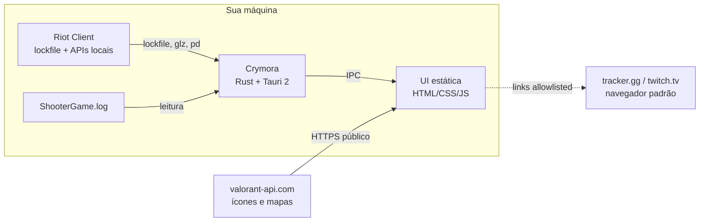
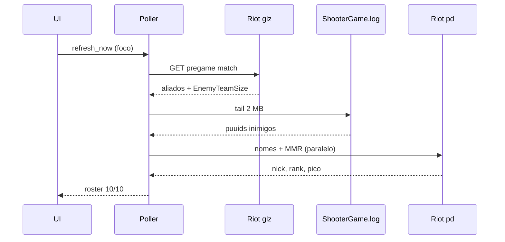

# Arquitetura

Este documento descreve como o Crymora é organizado, de onde vêm os dados e quais são os limites de segurança do projeto.

## Visão geral

O Crymora é um aplicativo desktop Tauri 2 com duas camadas:

- **Backend em Rust** (`src-tauri/src`): descobre o Riot Client, autentica nas APIs locais, faz polling, normaliza os dados e expõe comandos IPC.
- **Frontend estático** (`ui/`): HTML, CSS e JavaScript puro, sem framework, sem bundler e sem npm. É servido diretamente pelo Tauri a partir de `frontendDist: ../ui`.

Não existe servidor intermediário. O binário fala diretamente com o Riot Client local e com endpoints do próprio Riot.



## Componentes do backend

| Arquivo | Responsabilidade |
| --- | --- |
| `main.rs` | Entrada do executável. |
| `lib.rs` | Bootstrap do Tauri, comandos IPC, tray, janela e allowlist de links. |
| `settings.rs` | Leitura/escrita de `settings.json` com whitelist de chaves booleanas. |
| `discord_rp.rs` | Rich Presence opcional no Discord. |
| `riot/lockfile.rs` | Descoberta do Riot Client e leitura do lockfile local. |
| `riot/region.rs` | Detecção de região, shard e host a partir do lockfile/ambiente. |
| `riot/remote.rs` | Cliente HTTP para glz/pd, nomes, MMR e normalização de ranks. |
| `riot/state.rs` | Poller, cache, montagem do roster, presenças e fallback dos inimigos. |

### Comandos IPC

O frontend só acessa o backend por comandos explícitos:

- `get_match_state`, `get_pregame`, `get_live_roster`, `get_friends`, `riot_status`
- `refresh_now`
- `open_external`
- `settings_get`, `settings_set`
- `quit_app`, `open_main_window`
- `js_diag` (diagnóstico)
- `tracker_proxy` (stub; não usado nesta versão)

## Fluxo de dados

### 1. Descoberta e autenticação

1. O backend localiza o lockfile do Riot Client.
2. Extrai porta, token e protocolo.
3. Detecta região/shard para montar os hosts `glz-*` e `pd.*`.
4. Usa o token local em memória para chamadas autenticadas ao próprio Riot.

O token nunca é gravado em log, nunca é enviado à UI e nunca sai para servidores de terceiros.

### 2. Polling

O `Poller` mantém um cache em memória e executa `tick()` em loop:

- **Menu:** intervalo de 1,5 s (`TICK_IDLE_MS`).
- **Pré-jogo / partida:** intervalo de 1 s (`TICK_ACTIVE_MS`).
- **Cache de MMR:** TTL de 10 minutos (`MMR_TTL_SECS`).
- **Foco:** a UI chama `refresh_now` ao receber `focus` ou `visibilitychange`, forçando um tick imediato.

Cada tick coleta presenças, fase da partida, roster e dados de elo. As consultas de MMR são feitas em paralelo para reduzir a latência.

### 3. Pré-jogo

O endpoint HTTP do pré-jogo entrega apenas o time aliado: `Teams` contém um único time e `EnemyTeam` vem nulo. O backend então:

1. Lê `EnemyTeamSize` (normalmente 5).
2. Lê os últimos 2 MB do `ShooterGame.log`.
3. Ancora na última linha `Pregame_GetMatch` da partida atual.
4. Coleta os puuids registrados em `Subject had empty display name. <uuid>` depois dessa âncora.
5. Remove o próprio jogador e os aliados, limita ao tamanho do time inimigo.
6. Enriquece cada puuid com nick e rank via PD.



### 4. Espera pelos ranks

O roster do pré-jogo só é publicado quando `ranks_ready` confirma que todos os jogadores têm elo resolvido — “unranked” confirmado também conta. Se alguma consulta falhar, `pregame_hold` libera a tela após 5 s (`RANK_WAIT_SECS`) com o que estiver disponível.

Isso evita a UI “piscar” com ranks incompletos e mantém a promessa de “deu Alt+Tab, já está tudo lá”.

### 5. Core-game

Durante a partida, o core-game já retorna os 10 jogadores em `Players`, cada um com `TeamID`. O backend identifica o time do jogador local e normaliza aliados e inimigos. Nomes ausentes são resolvidos em lote e ficam em cache.

## Frontend

O frontend é deliberadamente simples:

- `index.html` define as views (Home, Partida, Amigos, Tracker, Ajustes).
- `app.js` contém estado, i18n (pt-BR/en-US), renderização, busca local e integração IPC.
- `styles.css` concentra temas, densidade, animações e layout.
- `assets/` contém as fontes Geist e o logo.

A UI não acessa rede diretamente, exceto `valorant-api.com` para ícones e mapas, permitido pela CSP. Links externos passam pelo comando `open_external`, que valida o host no backend.

## Segurança

### Limites do modelo

- **Somente leitura:** nenhuma escrita em arquivos do jogo, nenhuma memória, nenhuma injeção.
- **Sem overlay:** a janela é um app desktop comum.
- **Sem automação:** nenhum input sintético.
- **Sem telemetria:** nenhum backend próprio.
- **Dados locais:** `%APPDATA%\crymora\settings.json` e `debug.log`.

### Controles técnicos

- CSP restritiva em `tauri.conf.json` (`default-src 'self'`, `object-src 'none'`, `form-action 'none'`).
- `connect-src` limitado a IPC e `https://valorant-api.com`.
- `img-src` limitado a `self`, `data:` e `https://media.valorant-api.com`.
- Links externos allowlisted no Rust: apenas `tracker.gg` e `twitch.tv` em HTTPS.
- Settings com whitelist de chaves e valores booleanos; o restante é descartado.
- Nenhuma permissão de opener para a página.

### Riscos conhecidos

- **Scouting:** exibir inimigos no pré-jogo é classificado pela Riot como uso não aprovado. O risco é documentado no README e no LEIA-ME do instalador.
- **Instalador não assinado:** sujeito ao SmartScreen até haver certificado de code signing.
- **APIs não oficiais:** endpoints locais do Riot Client podem mudar sem aviso e quebrar funcionalidades.

## Testes

Os testes unitários ficam em `src-tauri/src` e cobrem:

- parsing de região;
- parsing de MMR e pico de carreira;
- fallback de puuid via `PlayerIdentity.Subject`;
- parsing dos puuids inimigos no log;
- `ranks_ready` e timeout de `pregame_hold`;
- allowlist de links externos.

```powershell
cd src-tauri
cargo test --lib
```

Testes que exigem o Riot Client aberto são marcados como `ignored` e podem ser executados manualmente com variáveis de ambiente específicas.

## Decisões de projeto

- **Rust + Tauri 2** por gerar um binário leve, sem runtime Node e com WebView2 já presente no Windows.
- **Frontend sem framework** para manter o bundle pequeno e o build reprodutível.
- **Polling curto com atualização sob demanda** em vez de websockets, porque as APIs locais do Riot não expõem um canal estável para todos os dados necessários.
- **Cache em memória** para MMR e nomes, reduzindo chamadas e mantendo a UI responsiva.
- **Degradação graciosa:** qualquer falha de rede ou de API resulta em estado parcial, nunca em tela travada.
